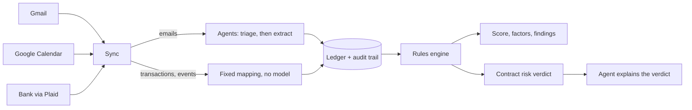

# Anchorpoint

**Audit-ready proof of your tax home, gathered for you, and a warning before your next contract puts your stipends at risk.**

Built in 24 hours at Hack Midwest. Live at **<https://172-232-25-241.sslip.io>**.

> Not tax advice. Anchorpoint organizes evidence and flags risk for a CPA to review. Every person, merchant, address and account in the demo is synthetic.

## The problem

A travel nurse takes about half of her pay as tax-free stipends for lodging and meals. That money is only tax-free while she can show she keeps a real home somewhere else: her **tax home**. If she can't, all of it becomes taxable wages, sometimes for years at once.

The IRS decides this on evidence, not on her word. For a worker with no regular workplace it looks at three factors:

1. Does she work in her home area?
2. Does she pay for a home there while also paying for housing on assignment?
3. Has she kept her ties there: family, trips back, licence, registration?

There is also a clock. An assignment expected to last more than a year in one place stops being temporary, and the stipends for it stop being tax-free.

The proof is a year of rent receipts, utility bills, flight confirmations and bank transactions, scattered across an inbox and a bank account. Almost nobody keeps it in order, and nobody checks the clock before signing an extension. The same test applies to contract engineers, travelling technicians and construction crews.

## What Anchorpoint does

Connect your email and bank once. After that:

- **It files the evidence for you.** An agent reads your inbox, works out which messages are tax-home evidence, extracts the facts and files each one in a ledger. Bank transactions are mapped by fixed rules.
- **Every record is traceable.** Each one links to the email or transaction it came from, with the quoted source text, the agent's confidence and a full audit trail. You confirm, reject or edit what the agent proposes.
- **It tells you where you stand.** A score, the three IRS factors, and specific findings such as "housing payment proof is missing for June".
- **It warns you before you sign.** Paste a recruiter's offer and get a verdict: go, review with a CPA, or high risk, with the reasons and questions to take to your CPA.

## How it works



Four rules shaped the design, and the code holds to all of them:

1. **Rules decide; the agent reads and explains.** Every finding and every verdict comes from deterministic, unit-tested rule code. The model extracts facts from documents and writes the plain-language explanation. It never creates, changes or removes a finding.
2. **Every record has provenance.** Nothing enters the ledger without a source reference and an audit event.
3. **Email is hostile input.** Document text is fenced before it reaches the model, output must pass a schema, and a code-level check blocks obvious instructions before any model call. The demo inbox contains an attack email; it is ignored and logged.
4. **Least privilege.** Read-only scopes, tokens encrypted at rest, snippets stored instead of full email bodies.

## What is real and what is not

| Part | Status |
| --- | --- |
| Google sign-in, Gmail API, token storage, sync loop | **Real**, against a dedicated demo inbox |
| Bank connection and transactions | **Real Plaid API**, sandbox mode |
| Triage, extraction and explanation | **Real**, live calls to Akamai-hosted inference through AWS Strands Agents |
| Rules, scoring, verdicts | **Real**, deterministic, tested |
| The ledger, audit trail, activity feed | **Real**, SQLite on the server |
| People, merchants, addresses, emails, transactions | **Synthetic** |
| Google Calendar connector | Built and merged; a late addition, lightly exercised |
| Assignment history (dates, pay) | A fixed list for the demo persona, not yet derived from her emails |
| CPA packet export, receipt uploads, more personas | **Not built** (see Roadmap) |
| Sign-in | None: one demo user |

## What you see

| Page | What it shows |
| --- | --- |
| Overview | Score, the three factors, findings, and a 12-month chart of home costs against stipends |
| Records | The evidence ledger. A payment found in both email and bank is one row with two sources |
| Agent activity | A live feed of what the agent found, filed, skipped and blocked |
| Contract check | Paste an offer; get a verdict, findings and an explanation that cites records |
| Timeline | Assignments, trips home and the one-year clock |
| Connections | What is connected, what it can read, and a revoke button |

## The rules

| Rule | Checks | Result |
| --- | --- | --- |
| R1 Housing continuity | A rent or mortgage payment in each of the last 12 full months | 1 missing: warn. 2 or more: high |
| R2 Utility continuity | A utility bill or payment at the home address in each of those months | warn |
| R3 Return trips | A trip home in every gap of 3+ days between assignments | warn |
| R5 One-year clock | Continuous time in one metro, joining contracts less than 30 days apart | 9+ months: warn. Over 12: high |
| R7 Stipend ceiling | Daily stipend against the federal high-low rate | warn |

Scoring weights the factors 30 / 40 / 30. A factor is met at 60, and the overall score reads strong at 75, needs attention at 50, at risk below. Rejected records never count. The thresholds are the team's heuristics for a CPA to review, not IRS numbers, and the 30-day continuity gap in R5 is a heuristic too. Rates live in `backend/app/rules/rates.json` (IRS Notice 2026-60), not in code.

Rules R4, R6, R8, R9 and R10 from the original plan are not implemented.

## Tech stack

| Layer | Used |
| --- | --- |
| Agents | **AWS Strands Agents**, structured output, no write tools |
| Model | **Akamai Cloud** hosted inference (OpenAI-compatible) |
| Hosting | **Akamai Cloud (Linode)** VM, Docker Compose, Caddy for HTTPS |
| Bank | **Plaid** Sandbox with a custom user |
| Backend | Python 3.12, FastAPI, Pydantic v2, SQLite (WAL), Server-Sent Events |
| Frontend | React, Vite, TypeScript, Tailwind, TanStack Query, Recharts |
| Security | Fernet-encrypted token vault, read-only OAuth scopes |

## Security and privacy

- **Scopes:** `gmail.readonly` and `calendar.readonly`. The app cannot send, change or delete mail.
- **Tokens:** encrypted at rest with Fernet, never logged, never sent to the browser. The vault refuses to start without a key.
- **Two OAuth clients, kept apart.** The app's client only reads. A separate client seeds the demo inbox, and the server holds only an insert-only grant from it for the "send a live email" demo button.
- **Data minimization:** the ledger stores extracted fields, a short snippet and a source ID, not full email bodies.
- **Prompt injection:** fenced input, schema-validated output, a deterministic pre-check, and no tool that can alter findings. Covered by tests.
- **Revoke:** withdraws the grant at the provider, drops the tokens, and can delete what was read.
- **Budget:** a per-sync cap on model requests.

Before any real user connects an inbox, Google's restricted-scope verification and a third-party security assessment would be required. The consent screen is in Testing mode, so Google shows an "unverified app" warning and only listed test users can sign in.

## Live deployment

| | |
| --- | --- |
| URL | <https://172-232-25-241.sslip.io> |
| API | <https://172-232-25-241.sslip.io/api/health> |
| Host | Akamai Cloud (Linode) VM, Chicago, public IP `172.232.25.241` |
| Runs | `docker compose` from this repo's `main`, in `/opt/anchorpoint` |
| HTTPS | Caddy, with a Let's Encrypt certificate for the `sslip.io` name |

`sslip.io` is a public DNS service that resolves `172-232-25-241.sslip.io` to that IP, which gives the server a hostname Google OAuth accepts.

**The server does not update when a PR merges.** A deploy is a manual step over SSH, and only P4 has access. Code reaches the server from GitHub; data reaches it from Gmail, Plaid and the inference API directly. Keys live in the server's `.env` and are not in this repo.

**Reset demo wipes the live ledger for everyone** and takes a few minutes to refill. Announce it before pressing it.

The three-minute walkthrough is in [docs/DEMO.md](docs/DEMO.md).

## Run it locally

You need Docker.

```bash
cp .env.example .env      # fill in the keys you have; the app starts with none
docker compose up -d --build
bash scripts/smoke.sh     # SMOKE GREEN; "wait" lines are things not set up on this machine
```

- App: <http://localhost>
- API: <http://localhost/api/health> (also on <http://localhost:8000> for the local OAuth redirect)

Without keys the site still runs: it loads fixture records and the model-written explanation falls back to a template. `make up`, `make down`, `make logs`, `make test`, `make smoke` and `make deploy` wrap the same commands.

### Tests

```bash
docker compose run --rm -e DATABASE_URL=sqlite:////tmp/test.db api python -m pytest -q
```

About 390 backend tests and 40 frontend tests. `backend/app/tests/test_scoring.py` pins the demo story: the persona's seeded data, run through the real mapping and rules, must produce the planned findings.

## Three containers

| Service | What it is | Reached at |
| --- | --- | --- |
| `caddy` | Front door. HTTPS on the server, plain HTTP locally | ports 80 / 443 |
| `api` | FastAPI backend, SQLite on the `api-data` volume | `/api/*` |
| `web` | The built React app, served by Caddy | everything else |

## Repo layout

```text
backend/app/
  main.py            app and router wiring
  models.py          shared contract models
  connectors/        gmail.py, calendar.py, plaid.py, google_oauth.py
  vault/             encrypted token store
  agents/            triage, extractor, auditor, pipeline, prompts
  sync/              orchestrator: connector -> agents or mapping -> ledger
  ledger/            records and the append-only audit trail
  rules/             rule engine and rates.json
  scoring.py         factors, score, verdict, monthly rows
  routers/           oauth, connections, records, activity, assessment, risk, sync, demo
  seed/              persona -> synthetic emails, bank transactions, calendar events
frontend/            React app (see frontend/README.md)
contract/fixtures/   profile and assignments for the demo persona
docs/DEMO.md         the three-minute demo script
scripts/             personas/, seed_gmail.py, seed_calendar.py, smoke.sh, deploy.sh, gate checks
```

## Environment variables

Copy `.env.example` to `.env`. It is gitignored: never commit it, and never paste keys into chat.

| Variable | Purpose |
| --- | --- |
| `SITE_ADDRESS` | `:80` locally; the bare domain on the server, which turns on HTTPS |
| `VITE_API_MODE` | `auto` falls back to fixtures for missing endpoints; `live` never does (used on the server) |
| `GOOGLE_CLIENT_ID`, `GOOGLE_CLIENT_SECRET` | The app's OAuth client (Web application) |
| `OAUTH_REDIRECT_URI` | Must match a redirect URI registered on that client |
| `FRONTEND_URL` | Where the OAuth callback returns to; empty on the server |
| `SEED_GOOGLE_CLIENT_ID`, `SEED_GOOGLE_CLIENT_SECRET` | The seeder client (Desktop app), used by `/api/demo/inject` |
| `PLAID_CLIENT_ID`, `PLAID_SECRET`, `PLAID_ENV` | Plaid Sandbox |
| `INFERENCE_BASE_URL`, `INFERENCE_API_KEY`, `MODEL_ID` | Akamai hosted inference |
| `TOKEN_ENC_KEY` | Fernet key for the vault |
| `DATABASE_URL` | SQLite path inside the `api` container |
| `SEED_FIXTURES` | `1` loads fixture records into an empty ledger; `0` on the server |
| `SYNC_INTERVAL_S` | Seconds between background syncs; `0` turns the poll off |
| `ALLOWED_ORIGINS` | Comma-separated CORS origins |
| `DEPLOY_HOST`, `DEPLOY_DIR`, `BASE_URL` | Only on the machine that runs `make deploy` |

## Demo data

Everything comes from one spec, `scripts/personas/maya.yaml`, with dates relative to the day you seed. Maya Torres is an ICU travel nurse with a home in Kansas City: about ten months in Denver, one rent month with no proof, one gap between assignments with no trip home, and an extension offer that would take her past a year.

```bash
# Preview the inbox without touching anything
docker compose run --rm -e PYTHONPATH=/srv -v ./scripts:/srv/scripts api \
    python scripts/seed_gmail.py --dry-run

# Fill the demo inbox (opens a Google sign-in for the demo account; --clear trashes what is there)
docker compose run --rm -p 127.0.0.1:8765:8765 -e PYTHONPATH=/srv \
    -v ./scripts:/srv/scripts -v /path/to/seeder_client.json:/secrets/seeder.json:ro \
    api python scripts/seed_gmail.py --client /secrets/seeder.json --clear
```

The inbox holds evidence, about fifty noise emails, two near-misses (a friend's bill, a roommate's receipt) and one attack email. Bank data comes from `backend/app/seed/bank.py`, which the bank connection plants in the Plaid sandbox.

## Deploy

`make deploy` runs `scripts/deploy.sh`: it backs up the SQLite file, pulls `main` on the server, rebuilds, reconnects the bank and runs the smoke test against `BASE_URL`. It prints the commit it deployed.

The bank connection and the extraction cache are held in memory, so both are lost on a restart. The script reconnects the bank; the first reset after a deploy re-reads the inbox through the model and takes a few minutes.

## Limitations

- One user and one persona. The backend has a single ledger, profile and set of connections.
- The contract check reads a labelled offer (`Start: 2026-10-20`, `Lodging stipend: $1,750/week`). Free-form recruiter emails are not parsed yet.
- Assignment history is a fixed list, not built from the assignment emails the agent already files.
- The contract check's explanation takes 10 to 30 seconds; the verdict itself is immediate.
- Five of the ten planned rules are implemented.
- Text messages and location history are out of reach for a web app.

## Roadmap

CPA packet export with an evidence index. Receipt and screenshot uploads with image reading. Assignments derived from email. The remaining rules. More connectors (Outlook, Drive, payroll portals) behind the same interface. Multi-user accounts. Google restricted-scope verification, key management, retention policy and a SOC 2 path. An employer and staffing-agency view, since they carry exposure on per diems too.

## Team

Four people, one module each, joined by a contract frozen in the first hour.

| Role | Owned |
| --- | --- |
| P1 Agents and Plaid | Triage, extraction, auditor, injection defenses, Plaid and Calendar connectors |
| P2 Platform, rules and security | Contract models, ledger, rules engine, records API, risk check |
| P3 Frontend | Every screen |
| P4 Infra, Google and data | Deployment, Google OAuth, Gmail connector, vault, sync, scoring, seed data |
